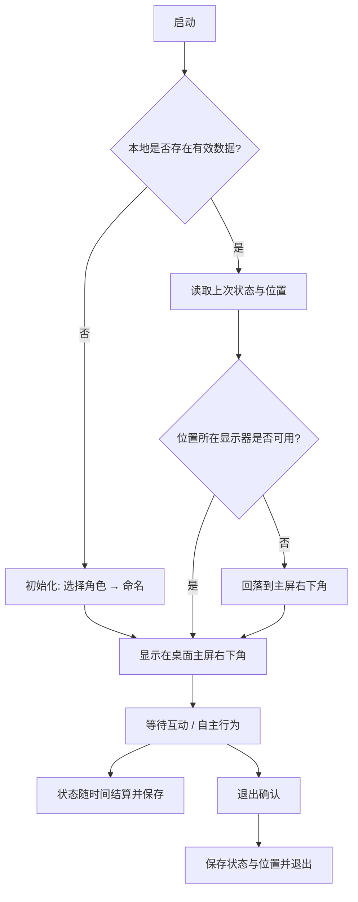
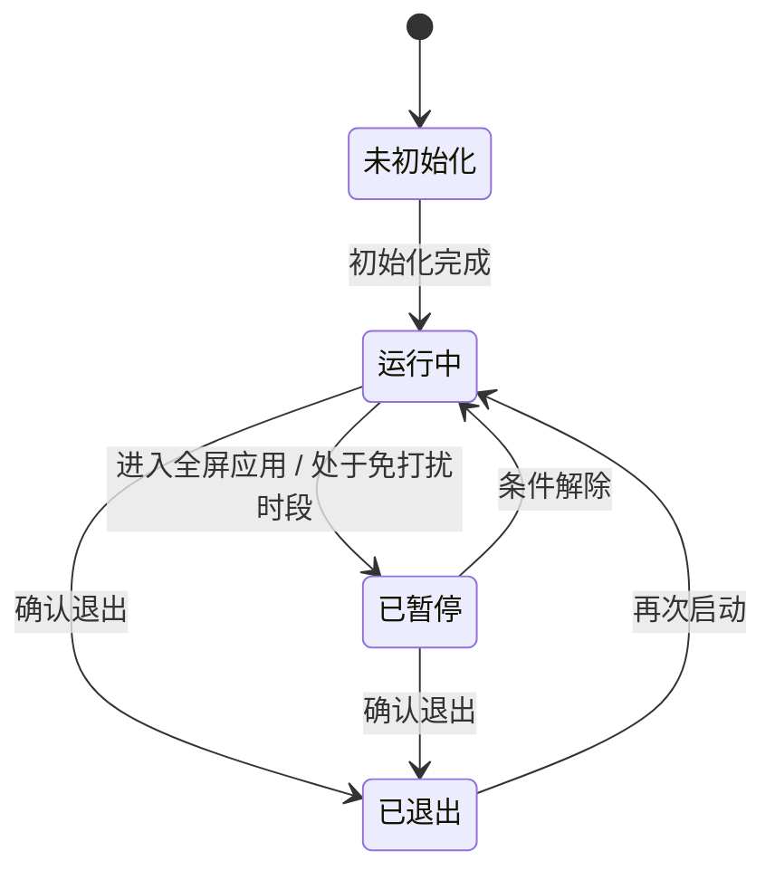

# 桌宠 产品需求文档

| 项目 | 内容 |
|---|---|
| 产品名称 | 桌宠（暂定名，正式名称 [TBD]） |
| 文档版本 | v0.1（草案） |
| 更新日期 | 2026-11-13 |
| 文档范围 | 桌面端单机产品，覆盖首次启动到日常使用的完整核心流程 |
| 目标读者 | 产品、设计、开发、测试 |

---

## 1. 背景与目标

长时间在电脑前工作、学习的人，桌面上的工具大多是功能型的：写文档、开会、跑任务。现有虚拟宠物类产品要么需要用户停留在游戏界面里，要么以弹窗和系统通知的方式打断当前工作。

- 受影响用户与场景：以电脑为主要工作工具、每天连续使用数小时、希望桌面上有一点陪伴感但不愿被打断的人。
- 产品决策：做一只常驻桌面、低打扰、随时可互动的桌宠。它不要求用户投入大量时间，也不以任务和奖励驱动，价值来自「存在感」与「可预期的小反馈」。
- 可观察结果：用户启动后无需配置即可在桌面看到角色；无人操作时角色会自己活动；点击一次就能得到反馈；退出再启动后，角色状态与位置与离开时一致。

### 1.1 目标

1. 首次启动不注册、不联网，用户在初始化流程内即可让角色出现在桌面。
2. 角色的存在不干扰用户的正常操作：不抢焦点、不遮挡正在操作的内容、不在用户明确休息或开会时主动打扰。
3. 互动有即时、可感知的反馈，且反馈可重复获得，不需要长时间"肝"。
4. 角色状态跨重启保留，用户离开一段时间回来后能看出变化。

### 1.2 设计取向

- 陪伴优先于挑战：不设置失败、死亡、惩罚性流失。
- 低打扰优先于活跃度：宁可少出现，也不要打断用户。
- 离线优先：无网络时全部核心功能可用。

---

## 2. 用户与产品契约

| 项 | 定义 |
|---|---|
| 主用户 | 个人用户，单机单用户使用，无账号体系 |
| 使用触发 | 双击桌面图标启动，或用户开启开机自启后随系统启动 |
| 核心任务 | 在桌面上获得不打断工作的陪伴与轻量互动 |
| 完成条件 | 角色在桌面可见、可互动；关闭后再次启动，状态与位置恢复 |
| 信任边界 | 仅在本机读取「用户是否空闲」「是否处于全屏应用」两类状态；不截屏、不记录窗口内容、不上传任何数据 |

本产品只有一种用户角色，不存在多角色协作、权限分配与数据共享场景。

### 2.1 对象模型

| 对象 | 说明 | 关键属性 |
|---|---|---|
| 角色 | 桌面上的宠物本体，用户唯一关注的对象 | 名称、外观包、缩放档位、当前动作 |
| 状态 | 角色的三个养成数值 | 心情、饱腹、精力 |
| 位置 | 角色在各显示器上的落点 | 显示器标识、相对坐标 |
| 设置 | 用户偏好 | 置顶、全屏隐藏、自启、音效、免打扰、大小 |
| 提醒计划 | 用户开启的提醒，P1 能力 | 类型、间隔、最近触发时间、是否暂停 |

---

## 3. 范围

### 3.1 P0（必须完成）

1. 首次启动与初始化。
2. 桌面驻留与窗口行为：透明、拖拽、置顶、全屏隐藏、多显示器、托盘。
3. 基础互动：单击、拖拽、右键菜单、喂食、抚摸。
4. 状态养成：心情、饱腹、精力随时间变化，跨重启保留。
5. 设置：置顶、全屏隐藏、开机自启、音效、免打扰时段、角色大小。
6. 退出、数据保存与本地数据删除。

### 3.2 P1（本期不阻塞发布）

1. 喝水、久坐提醒。
2. 专注计时陪伴（用户开启一段专注，角色在旁陪伴，结束时给出反馈）。
3. 外观包与多角色切换。
4. 点击穿透模式。
5. 全局快捷键唤起或隐藏角色。

### 3.3 明确不做

社交与好友、账号与云同步、内购与付费皮肤商城、宠物对战、剧情任务、移动端与网页版。

---

## 4. 核心流程与状态模型

### 4.1 核心使用流程

### 4.2 运行时状态

说明：`已暂停` 只抑制角色的主动行为与提醒，状态数值仍按时间正常结算，避免用户回来时状态"冻结"。

---

## 5. 功能需求

### 5.1 FR-01 首次启动与初始化

**目的**：让用户在不理解产品任何概念的情况下，直接看到桌宠。

**触发**：启动时本地不存在有效数据。

**规则**：

1. 初始化只有两屏，顺序固定：选择角色 → 命名。
2. 选择角色页默认选中第一个角色，用户可直接点「下一步」，不需要先做选择才算完成。
3. 命名页默认填入一个内置名字，用户可跳过；名字限制 1–12 个字符，前后空格自动去除。
4. 全流程不要求注册、登录、联网或填写任何个人信息。
5. 完成后角色立即出现在主显示器右下角，不遮挡任务栏。
6. 初始化过程中关闭应用，下次启动重新进入初始化。

**异常**：

- 角色资源缺失或损坏：使用内置兜底形象完成初始化，并在设置页的「关于」中提示资源异常。
- 写入本地数据失败：角色仍可正常显示与互动，退出时再次尝试保存；连续失败时在设置页提示「本次状态无法保存」。

### 5.2 FR-02 桌面驻留与窗口行为

**目的**：让角色像桌面的一部分，而不是一个需要切换过去的应用窗口。

**规则**：

1. 角色以无边框、背景透明的方式显示，桌面只出现角色本体，不出现窗口边框、标题栏和白色底。
2. 默认始终置顶，可在设置中关闭；关闭后角色会被其他窗口正常遮挡。
3. 默认不占用任务栏位置，托盘常驻图标提供显示/隐藏与退出入口。
4. 角色可被鼠标拖拽到屏幕任意位置；松手后记录位置，下次启动按记录恢复。
5. 位置按显示器分别记忆；角色被拖到副屏后，下次启动仍在副屏原位置。
6. 角色大小提供小、中、大三档，默认中档，以角色高度为基准等比缩放，切换后位置保持相对屏幕比例不变。
7. 全屏应用期间默认自动隐藏角色，退出全屏后自动恢复；设置中可改为保持显示。
8. 拖拽角色时角色跟随指针移动，松手后播放一次落地动作，停在松手位置。

**边界与异常**：

- 位置所在显示器被断开：下次启动或显示器变化时，角色回落到主屏右下角。
- 分辨率变化导致记录位置超出屏幕：将角色修正到最近的可见区域内，不直接回到默认位置。
- 全屏检测不可用（系统未提供该状态）：视为非全屏，角色保持显示。
- 系统休眠唤醒：角色恢复到唤醒前位置，状态按 5.4 的规则统一结算一次，不补播多个动画。

### 5.3 FR-03 基础互动

**目的**：用最少的操作获得明确、即时的回应。

| 动作 | 触发方式 | 效果 | 冷却 | 边界 |
|---|---|---|---|---|
| 点击回应 | 单击角色 | 播放一次反馈动作并显示一句台词，不改变状态数值 | 1 秒 | 连续快速点击不叠加动画，只重置台词 |
| 拖拽 | 按住并移动角色 | 角色跟随指针，改变位置 | 无 | 拖拽过程中不响应点击与右键菜单 |
| 喂食 | 右键菜单选择「喂食」 | 饱腹 +20，心情 +5 | 30 分钟 | 饱腹 ≥ 90 时拒绝，提示「吃不下了」 |
| 抚摸 | 右键菜单选择「抚摸」 | 心情 +8 | 60 秒 | 拖拽中不可用 |
| 菜单 | 右键角色 | 打开功能菜单 | 无 | 菜单项见 5.3.1 |

**自主行为规则**：

1. 用户连续 5 分钟无键鼠操作时，角色进入自主行为状态，按外观包内置的动作集播放待机、张望、走动、打瞌睡等动作。
2. 自主行为每 10 分钟最多触发 1 次，不抢占前台焦点，不出现全屏遮罩。
3. 状态处于低落档位（见 5.4）时，自主行为频率减半，并且不再主动靠近屏幕中央。
4. 全屏应用或免打扰时段内，自主行为完全停止。

#### 5.3.1 右键菜单结构

| 菜单项 | 行为 |
|---|---|
| 喂食 | 执行喂食，受冷却与饱腹上限约束 |
| 抚摸 | 执行抚摸，受冷却约束 |
| 设置 | 打开设置窗口 |
| 隐藏角色 | 角色从桌面消失，托盘图标保留；再次点击托盘图标恢复 |
| 退出 | 触发退出确认 |

菜单在角色靠近屏幕边缘时自动向内展开，保证完整可见。

### 5.4 FR-04 状态与养成

**目的**：让角色在用户离开和回来之间有可感知的变化，而不是一个永远不变的形象。

| 状态值 | 范围 | 初始值 | 随时间变化 | 提升方式 |
|---|---|---|---|---|
| 心情 | 0–100 | 80 | 每小时 −1 | 抚摸 +8，喂食 +5 |
| 饱腹 | 0–100 | 70 | 每小时 −6 | 喂食 +20 |
| 精力 | 0–100 | 80 | 清醒时每小时 −4；23:00–07:00 且无操作时每小时 +8 | 夜间休息 |

以上初始值与变化速率均为 `[Assumption, TBD]`，正式数值需在体验验证后确定，且应可通过配置调整。

**表现档位**：

| 档位 | 条件 | 表现 |
|---|---|---|
| 良好 | 心情 ≥ 70 且饱腹 ≥ 30 | 动作完整，台词丰富，正常触发自主行为 |
| 一般 | 心情 30–69，或饱腹 1–29 | 动作正常但台词减少，自主行为频率降低 |
| 低落 | 心情 < 30 | 动作放缓、低头，不主动靠近，只响应点击与喂食 |

**规则**：

1. 三个数值独立结算，按真实经过时间计算，不依赖应用是否在运行。
2. 应用未运行时同样结算，单次离线最多结算 12 小时，超出部分不再累积；该上限为 `[Assumption, TBD]`。
3. 数值不会导致角色死亡、消失或永久无法使用；最低档位只影响表现与互动意愿。
4. 数值可通过悬停角色后出现的状态面板查看，面板在移开指针后自动收起，不常驻显示。
5. 喂食、抚摸带来的数值变化立即生效，并立即触发一次对应动画。
6. 时间结算后，若跨过档位阈值，角色在下一次出现时播放一次对应的过渡动作。

**异常**：

- 系统时间被向前调整：单次结算上限仍为 12 小时，避免数值瞬间归零。
- 系统时间被向后调整：不产生负向结算，状态保持不变。

### 5.5 FR-05 提醒与专注陪伴（P1）

**目的**：在用户长时间不动时给出一次轻提示，但不把桌宠变成闹钟。

**规则**：

1. 喝水提醒、久坐提醒默认关闭，需用户在设置中主动开启。
2. 提醒以角色动作加气泡的形式出现，不发送系统通知、不播放提示音，除非用户单独开启提醒音效。
3. 同类提醒每小时最多 1 次；免打扰时段内所有提醒不触发，时段结束后不补发。
4. 提醒出现时提供「知道了」和「稍后提醒」两个操作，选择「稍后提醒」后 15 分钟再提示一次，仅一次。
5. 专注计时由用户主动开始，可选择 15/25/45 分钟；计时期间角色保持安静陪伴，结束时报时一次。

### 5.6 FR-06 设置

**入口**：右键菜单「设置」、托盘菜单「设置」。

| 设置项 | 默认值 | 可选值 | 说明 |
|---|---|---|---|
| 始终置顶 | 开 | 开 / 关 | 关闭后角色可被其他窗口遮挡 |
| 全屏应用时隐藏 | 开 | 开 / 关 | 关闭后角色在全屏应用上保持显示 |
| 开机自启 | 关 | 开 / 关 | 开启后随系统登录启动 |
| 音效 | 开 | 开 / 关 | 控制互动音效与提醒音效 |
| 音量 | 50% | 0–100% | 音效关闭时置灰 |
| 免打扰时段 | 22:00–08:00 | 可关闭，可自定义起止时间 | 期间停止自主行为与全部提醒 |
| 角色大小 | 中 | 小 / 中 / 大 | 切换后保持相对位置 |
| 语言 | 简体中文 | `[TBD]` | 是否提供其他语言待定 |
| 删除本地数据 | — | — | 二次确认后清除数据并回到初始化 |
| 关于 | — | — | 版本号、资源状态、退出应用 |

**规则**：

1. 所有设置修改后立即生效，无需「保存」按钮。
2. 免打扰时段的开始时间可以晚于结束时间，表示跨天时段。
3. 免打扰时段与全屏隐藏同时满足时，隐藏优先：角色不可见，也不产生任何行为。
4. 「删除本地数据」需二次确认，确认文案明确说明角色名称、状态与位置将被清除且无法恢复；确认后立即执行，不提供撤销。

### 5.7 FR-07 退出、保存与数据

**规则**：

1. 退出入口为右键菜单「退出」与托盘菜单「退出」。
2. 退出前弹出一次确认，文案为「退出后桌宠将离开桌面，状态会被保存」，并提供「不再提示」勾选项；勾选后后续退出不再确认。
3. 退出时保存角色名称、三项状态值、最近结算时间、各显示器位置、缩放档位与全部设置。
4. 保存失败不阻塞退出，下次启动回退到最后一次成功保存的数据。
5. 所有数据仅保存在本机，产品不联网、不上传状态或使用记录。
6. 应用被强制结束或崩溃后，下次启动读取最后一次保存点；数据损坏时回到默认状态，并在初始化完成后提示一次「上次的状态未能恢复」。

### 5.8 FR-08 异常与恢复汇总

| 场景 | 处理 |
|---|---|
| 角色资源缺失 | 使用内置兜底形象，正常完成初始化与互动，并在「关于」中提示 |
| 显示器断开或分辨率变化 | 位置修正到当前可见区域，必要时回落主屏右下角 |
| 系统休眠唤醒 | 只结算一次状态，不补播动画、不补发提醒 |
| 本地数据损坏 | 回到默认状态，提示一次，不阻断使用 |
| 保存失败 | 不阻塞退出，下次回退到最后一次成功保存点 |
| 全屏状态读取失败 | 视为非全屏，角色保持显示 |
| 长时间无人操作 | 只降低自主行为频率，不退出、不隐藏 |

---

## 6. 共享规则

### 6.1 打扰优先级

`免打扰时段 > 全屏应用隐藏 > 自主行为 > 提醒`。高优先级条件成立时，低优先级行为一律不触发；条件解除后不补发被抑制的行为与提醒。

### 6.2 状态结算

所有状态变化以「最近结算时间」为起点按真实时间计算；单次结算上限 12 小时；结算后立即更新最近结算时间。互动带来的即时增减在结算之后叠加。

### 6.3 冷却

| 动作 | 冷却时长 | 冷却期间表现 |
|---|---|---|
| 点击回应 | 1 秒 | 不重复播放动画 |
| 喂食 | 30 分钟 | 菜单项置灰并显示剩余时间 |
| 抚摸 | 60 秒 | 菜单项置灰并显示剩余时间 |
| 自主行为 | 10 分钟 | 不触发新的自主动作 |

### 6.4 保存时机

初始化完成、每次互动生效后、每次位置变化松手后、每次设置变更后、退出时。保存动作不得造成可感知的卡顿。

### 6.5 文案

台词语义保持中性、短句，单句不超过 12 个汉字；不出现指责、催促、道德绑架类表达（如「你都不理我了」）。

### 6.6 焦点与遮挡

角色任何状态下都不抢占键盘焦点；自主行为不覆盖当前活动窗口的主要内容区域；菜单与气泡始终完整显示在屏幕可见范围内。

---

## 7. 待定问题

| 编号 | 问题 | 影响 |
|---|---|---|
| Q1 | 角色形象为原创还是外部授权 IP | 影响资源制作、上线合规与成本 |
| Q2 | 首发支持哪些操作系统 | 影响全屏检测、置顶、自启等能力的实现边界与测试范围 |
| Q3 | 是否提供付费外观包 | 影响设置页结构与后续版本规划 |
| Q4 | 提醒是否允许升级为系统通知 | 影响免打扰规则与用户打扰预期 |
| Q5 | 是否需要多语言 | 影响文案规模与设置项 |
